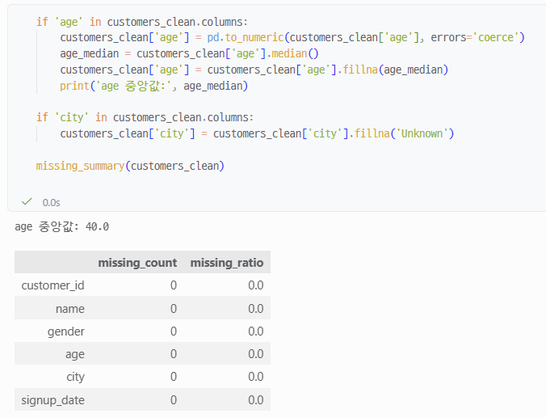
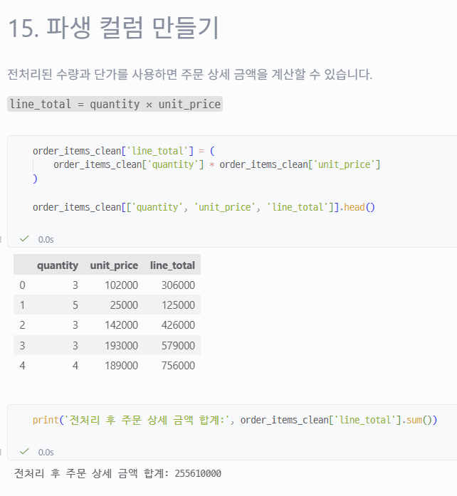
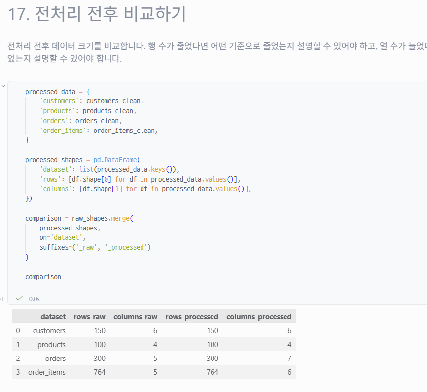

# Chapter 05 제출 답안 양식. 분석을 믿을 수 있게 만드는 데이터 전처리

> 주 제출물은 실행 완료 Notebook `chapter05/chapter05.ipynb`입니다. 이 양식의 항목을 Notebook의 Markdown 셀로 추가해 작성합니다.

## 0. 제출 정보
- 이름: 배성윤
- GitHub ID: aeuyui
- 작성일: 2026-10-12
- 최종 제출 URL: https://github.com/aeuyui/llm-data-analysis-study/blob/main/chapter05/chapter05.ipynb

## 1. 전처리 전 상태 기록
- 각 데이터 shape:

|data file|shape|column|
|---|---|---|
customers|(150,6)|'customer_id', 'name', 'gender', 'age', 'city', 'signup_date'|
products|(100,4)|'product_id', 'product_name', 'category', 'price'|
orders|(300,5)|'order_id', 'customer_id', 'order_date', 'payment_method', 'order_status'|
order_items|(764,5)|'order_item_id', 'order_id', 'product_id', 'quantity', 'unit_price'|

- 결측치: 4개 데이터 파일 모두 결측치 없음
- 전체 중복: 4개 데이터 파일 모두 중복 없음
- 주요 ID 중복: 4개 데이터 파일 모두 ID 중복 없음
- 타입 문제 후보: 문자열 데이터는 앞뒤 공백이 존재할 수 있으므로, 실제로 같은 값을 의미하지만 pandas에서는 다른 값으로 집계될 수 있다.

.png)

.png)

### 결과 관찰
- 4개 파일 모두 결측 0건, 전체 중복 0건, 주요 ID 중복 0건이다.
- orders는 300행, order_items는 764행이다. 주문 1건당 여러 개의 상세 행이 연결되는 구조이므로, order_items.order_id가 반복되는 것은 한 주문에 여러 상품이 들어갈 수 있는 자연스러운 반복이다.

### 나의 해석과 판단
결측, 전체 중복, ID 중복은 모두 0건이라 이 세 항목에서는 처리할 문제가 없다.
아직 확인하지 않은 것은 문자열 공백, 숫자/날짜 타입, 범주 표기, 이상값, 파일 간 관계이므로 이 중에서 같은 값을 다르게 집계할 수 있는 문자열 공백과 계산 및 월별 분석에 영향을 주는 숫자/날짜 타입 변환을 먼저 확인하는 것이 순서라고 판단했다. 이후 범주값 표기, 이상값 후보를 보고, 마지막에 파일 간 관계를 다시 검증할 것이다.

### 업무·분석적 의미
이 표가 전처리 전/후 비교의 기준점이다. 이후 행 수나 열 수가 달라지면 이 값과 비교해 의도한 변화인지 판단할 수 있다. 또 주문 건수(300)와 주문 상세 행 수(764)는 집계 단위가 다르므로 분석할 때 구분해야 한다.

### 한계와 추가 확인 사항
- step1에서는 결측, 전체 중복, ID 중복만 확인했다. 공백, 타입, 범주 표기, 값의 범위, 파일 간 관계는 2~4단계에서 확인한다.
- 기본 샘플 데이터라서 문제가 적게 나온 것일 수 있다. 실제 업무 데이터에서도 같은 결과가 나온다고 일반화할 수 없다.

## 2. 문자열·타입·결측 처리
- 적용한 문자열 정리: 4개 데이터의 문자열 컬럼 앞뒤 공백을 제거했다. 결측값은 문자열 'nan'으로 바뀌지 않도록 결측이 아닌 값에만 적용했다. 빈 문자열을 결측으로 바꾸는 처리는 적용하지 않았다.
- 숫자 변환 대상과 실패 건수: price, quantity, unit_price를 쉼표 제거 후 숫자로 변환했다.
- 날짜 변환 대상과 실패 건수: order_date, signup_date를 날짜형으로 변환했다. 주문일 범위는 2025-09-14 ~ 2026-09-13이다.
- 결측 처리 기준: age는 중앙값(40.0)으로 대체, city는 'Unknown'으로 대체하는 기준을 적용했다. 원본 결측이 0건이었으므로 실제로 바뀐 값은 없다.



### 결과 관찰
- 숫자 변환 3개 컬럼과 날짜 변환 2개 컬럼 모두 실패가 0건이다.
- 가장 늦은 주문일(2026-09-13)이 작성일(2026-10-12)보다 이전이라 미래 날짜는 없다.
- 공백 제거 후 order_status는 completed, cancelled, refunded 3개 값만 남았다.
- age와 city는 결측이 없어서 중앙값/Unknown 대체로 바뀐 값이 없다.

### 나의 해석과 판단
- 공백 제거는 'Seoul'과 ' Seoul'이 서로 다른 값으로 집계되는 문제를 막기 위해 적용했다. 결측은 건드리지 않아 정보를 잃지 않는다.
- errors="coerce"는 변환 실패를 NaN/NaT로 바꾸므로, 실행만 하지 않고 실패 건수를 직접 확인해야 한다. 이번에는 모두 0건이라 그대로 사용할 수 있었다.
- age는 숫자형이라 중앙값을 쓰고, city는 범주형이라 대표값이 없으므로 Unknown으로 대치하기로 하였다. 
- 삭제나 대체는 정보 손실을 만들 수 있다. 중앙값 대체는 여러 고객이 같은 나이로 보이게 하여 나이 분포를 좁히고, 왜 비어 있었는지라는 정보가 사라진다. Unknown은 결측을 하나의 범주처럼 취급하게 만든다. 고유 ID, 핵심 날짜, 금액, 상태값은 근거 없이 대표값으로 대체하지 않는다.

### 업무·분석적 의미
날짜가 날짜형으로 바뀌어 월별/요일별 분석이 가능하고, 가격과 수량이 숫자형이라 이후 금액 계산(line_total)에 사용할 수 있다. 공백을 정리해 두었으므로 도시·상태별 집계가 쪼개지지 않는다.

### 한계와 추가 확인 사항
- 실행파일에서는 공백 제거로 몇 건이 바뀌었는지는 출력하지 않아 원본에 공백이 실제로 있었는지는 확인하지 못했다.
- age는 셀 8에서 숫자 변환 직후 바로 결측을 채우므로, 변환 실패가 있었더라도 중앙값에 가려질 수 있다. age의 변환 실패 건수는 따로 출력되지 않았다.

## 3. 중복·범주 표준화·이상값 후보
- 제거/보류한 중복: 전체 행 중복은 4개 데이터 모두 0건이라 제거된 행이 없다. 고유 ID 중복도 0건이라 보류할 것이 없다. order_items.order_id의 반복은 한 주문에 여러 상품이 들어갈 수 있는 자연스러운 반복이므로 중복으로 보지 않았다.
- 표준화한 범주값: order_status에 complete/완료  completed, cancel/취소 -> cancelled, refund/환불 -> refunded 매핑을 적용했다. 표준화 전후 값 분포가 같아서(completed 184, cancelled 64, refunded 52) 실제로 바뀐 값은 없다.
- 허용값 밖 값: order_status는 대표 상태 3개(completed, cancelled, refunded) 외의 값이 0건이다. 다른 범주 컬럼(gender, payment_method, category 등)은 점검하지 않았다.
- 이상값 후보: price <= 0, quantity <= 0, unit_price <= 0 모두 0건이다. 값 범위는 price 5,000~200,000, quantity 1~5, unit_price 5,000~200,000이다. age의 0 미만/120 초과 점검은 하지 않았다.

.png)

.png)

### 결과 관찰
- 중복과 ID 중복은 모두 0건이라 삭제된 행이 없다.
- 상태값은 표준화 전에도 이미 3개 대표값뿐이었다.
- 0 이하 가격·수량·단가가 없어서 이상값 처리로 제외된 행이 없다. 처리 전후 shape가 같다.

### 나의 해석과 판단
- 이상값은 일반적인 범위를 벗어난 값일 뿐 항상 오류는 아니다. 이상적인 범위에는 벗어나지만 유의미한 데이터일 수 있으므로, 섣불리 삭제하는 것이 아니라 다른 변수들까지 종합하여 의미를 파악하고 삭제 또는 유지를 결정해야한다.
- 삭제하면 파일 간 관계도 깨질 수 있다. products에서 일부 상품을 제외하면 order_items에 그 product_id가 남아 참조가 끊긴다.
- 이번 데이터는 후보가 0건이라 제외 없이 그대로 두는 것이 맞다고 판단했다.

### 업무·분석적 의미
중복,상태값,이상값 점검 결과가 모두 깨끗하므로 행 수(300 주문, 764 주문 상세)를 그대로 신뢰하고 이후 분석에 쓸 수 있다. 상태값이 3개로 통일되어 있어 주문 상태별 집계가 쪼개지지 않는다.

### 한계와 추가 확인 사항
- 노트북에서는 중복 제거가 문자열 공백 제거보다 먼저 실행된다. 공백만 다른 중복 행이 있었다면 걸러지지 않았을 수 있다. 이번 데이터에서는 제거된 행이 0건이라 확인된 문제는 없다.
- order_status 외의 범주 컬럼은 허용값을 점검하지 않았다. city는 셀 10에서 상위 10개 값만 출력했다.
- age 범위(0 미만, 120 초과)는 점검하지 않았다.

## 4. PK/FK와 파생 컬럼 재검증
- 없는 `customer_id`: 0건 (orders.customer_id가 customers.customer_id에 모두 존재)
- 없는 `order_id`: 0건 (order_items.order_id가 orders.order_id에 모두 존재)
- 없는 `product_id`: 0건 (order_items.product_id가 products.product_id에 모두 존재)
- 생성한 파생 컬럼: order_month(주문 월, 예: 2026-07), order_dayofweek(주문 요일, 예: Monday), line_total(주문 상세 한 행의 수량 x 단가)
- `line_total` 검증: 상위 5행을 직접 곱해 값이 일치함을 확인했다(예: 3 x 102,000 = 306,000). quantity와 unit_price는 숫자 변환 실패가 0건이고 0 이하 값이 없어 곱셈 결과가 안전하다. 전체 합계는 255,610,000이다.



### 결과 관찰
- 세 가지 참조 관계 모두 깨진 행이 0건이다. 직접 계산한 결과와 src.preprocessing의 validate_relationships 결과가 같다.
- 파생 컬럼 3개가 만들어져 orders는 5->7열, order_items는 5->6열이 되었다. 행 수는 그대로다(300, 764).
- line_total 합계는 255,610,000이다.

### 나의 해석과 판단
- 전처리 중 행을 삭제하면 관계가 깨질 수 있다. 예를 들어 products에서 일부 상품을 제외했는데 order_items에는 그 상품 ID가 남을 수 있다. 그래서 전처리가 끝난 뒤 다시 확인해야 한다. 이번에는 제외된 행이 없어서 0건이었다.
- line_total은 주문 상세 한 행의 수량 x 단가이다. 합계 255,610,000을 곧바로 매출이나 순매출이라고 할 수는 없다. 이 합계는 order_items 전체를 더한 값이어서 주문 상태를 구분하지 않았고, orders에는 cancelled 64건과 refunded 52건이 있으므로 이 주문들의 상세 금액도 포함되어 있다.
- 이 검증은 order_items에서 부모 파일로 가는 방향만 본다. 주문이 없는 고객이나 상세가 없는 주문이 있는지는 확인하지 않았다.

## 5. 전처리 전/후 비교
| 항목 | 처리 전 | 처리 후 | 변화 이유 |
| --- | ---: | ---: | --- |
| 행 수 | 150 / 100 / 300 / 764 (합계 1,314) | 150 / 100 / 300 / 764 (합계 1,314) | 중복 0건, 0 이하 값 0건이라 제거된 행이 없다. 결측은 삭제하지 않고 대체하는 기준이라 행이 줄지 않는다. |
| 결측 | 0 (4개 데이터 모두) | 0 (customers 전체와 변환 대상 컬럼 기준) | 원본 결측이 없어 대체된 값이 없다. 변환으로 새로 생긴 NaN/NaT도 없다. |
| 중복 | 0 (전체 행, 주요 ID) | 0 | 제거할 중복이 없었다. |
| 변환 실패 | 변환 전이라 해당 없음 | 0 (price, quantity, unit_price, order_date, signup_date) | errors="coerce"로 변환한 뒤 실패 건수를 직접 확인했다. |



### 결과 관찰
- 4개 데이터 모두 행 수가 전처리 전후로 같다(합계 1,314).
- 열 수는 orders 5->7(order_month, order_dayofweek), order_items 5->6(line_total)로 늘었다. 나머지는 같다.
- order_status 분포는 표준화 전후 모두 completed 184 / cancelled 64 / refunded 52로 같다.
- 노트북 직접 구현과 src.preprocessing 모듈의 비교 결과가 일치한다.

### 나의 해석과 판단
- 행이 줄어들 이유가 되는 조건이 모두 0건(전체 중복 0, 변환 실패 0, 0 이하 가격/수량/단가 0)이었기 때문에 행 수가 같은 것을 의도한 결과라고 판단했다. 행이 줄었다면 어떤 기준으로 줄었는지 설명할 수 있어야 한다.
- 열 수 증가는 새 파생 컬럼 3개로 설명된다.
- 값 분포(order_status)도 바뀌지 않아 표준화가 값을 의도치 않게 바꾸지 않았다고 판단했다.

### 업무·분석적 의미
전처리로 데이터가 사라지지 않았으므로, 이후 분석에서 주문 300건과 주문 상세 764행을 그대로 기준으로 쓸 수 있다. 다만 order_date 등이 날짜형/숫자형으로 바뀌었고 파생 컬럼이 늘어, 월별/요일별 분석과 금액 계산이 가능해졌다.

### 한계와 추가 확인 사항
- 원본 데이터의 품질이 이미 좋았기 때문에, 전/후가 같다는 결과는 전처리가 검증을 통과했다는 뜻이지, 전처리가 데이터를 개선했다고는 보기 어렵다.
- 처리 후 결측은 customers 전체와 변환 대상 컬럼만 확인했다. 4개 데이터 전체의 처리 후 결측은 따로 출력하지 않았다.
- 전/후 비교는 shape 위주이고, order_status 외 컬럼(age, price 등)의 분포 전후 비교는 하지 않았다. 처리 전 상태의 값 통계(describe)는 출력하지 않았고, 셀 14의 통계는 변환 이후 값이다.

## 6. 재현 가능한 전처리 확인
- 생성된 clean CSV: data/processed/customers_clean.csv, products_clean.csv, orders_clean.csv, order_items_clean.csv (4개). 스크립트 실행 결과에 저장 경로 4개가 출력되었다.
- 생성된 요약 보고서: reports/ch05_preprocessing_summary.md (스크립트 출력에 경로가 표시됨)
- `python scripts/preprocess_data.py` 재실행 결과: xx최종 PASS (처음 1회 FAIL 후 수정)xx
  - 처음 실행에서는 `ModuleNotFoundError: No module named 'src'`(스크립트 22행 `from src.data_loader import load_sales_data`)로 실패했다.
  - 원인은 `python scripts/preprocess_data.py`로 실행하면 scripts 폴더만 import 검색 경로에 들어가서, 프로젝트 루트의 src 폴더를 찾지 못한 것이다. 노트북은 셀 3에서 프로젝트 루트를 직접 sys.path에 추가했기 때문에 같은 import가 성공했다.
  - 스크립트의 import 앞에 아래 코드를 추가해 수정했다.

```python
import sys
from pathlib import Path

PROJECT_ROOT = Path(__file__).resolve().parents[1]
if str(PROJECT_ROOT) not in sys.path:
    sys.path.insert(0, str(PROJECT_ROOT))
```

  - 수정 후 재실행은 오류 없이 종료되었고, 전처리 전후 크기(150x6->150x6, 100x4->100x4, 300x5->300x7, 764x5->764x6), 중복 점검(행,ID 중복 모두 0), 관계 점검(invalid_count 모두 0), 저장 파일 4개, 보고서 경로가 출력되었다.
- 재실행 후 달라진 점: 수정 전에는 import 단계에서 실패했고, 수정 후에는 끝까지 실행되었다. 전처리 전후 크기,중복,관계 결과는 노트북 셀 17, 셀 21 결과와 같아서 노트북과 스크립트 결과가 일치한다. 노트북이 저장한 clean CSV와 보고서와 같은 경로에 저장했다.

.png)

.png)

### 나의 해석과 판단
- 노트북에서 실행이 성공하는 것은 셀을 위에서부터 순서대로 실행했고, 앞 셀의 변수와 경로 설정(셀 3)이 남아 있어서 성공한 것이다. 노트북에서는 같은 import가 되었지만, 스크립트는 경로 설정이 없어서 실패했다.
- 스크립트는 같은 입력(data/raw)에서 같은 순서로 처음부터 끝까지 실행되고, 실행할 때마다 결과 파일과 보고서를 만든다. 데이터를 다시 받거나 기준을 바꿔도 같은 명령 하나로 반복할 수 있고, 다른 사람도 재현할 수 있다.
- 노트북 직접 구현(셀 17)과 src 모듈/스크립트 결과가 같다는 점이 재현성을 뒷받침한다. 오류가 났을 때 처음에 실패한 사실과 수정 내용을 함께 기록해 두는 것도 재현을 위한 정보라고 판단했다.
- 스크립트가 쓰는 대상은 data/processed와 reports이고 data/raw는 읽기만 하므로 원본은 보존된다(스크립트 코드 기준).

## 7. Chapter 05 최종 판단
### 내가 정한 전처리 원칙 3가지
1. 원본(data/raw)은 덮어쓰지 않고 복사본에서 처리하며, 결과는 data/processed에 따로 저장한다.
2. 값을 바꾸거나 제외하기 전에 기준과 영향 건수(변환 실패, 대체, 제외)를 확인하고, 처리 전후 비교를 남긴다.
3. 이상값과 결측은 자동으로 삭제하거나 대체하지 않고 후보로 보고 업무 의미를 확인하며, 처리 후에는 PK/FK 관계를 다시 검증한다.

### 가장 위험하다고 생각한 자동 처리 1가지와 이유
0 이하의 price, quantity, unit_price를 기준만으로 자동 제외하는 처리(노트북 셀 14)가 가장 위험하다고 판단했다. 단순히 값만 보고 오류로 단정해 지우면 정상적인 업무 데이터를 잃을 수 있다.
- products에서 상품을 제외하면 order_items에 그 product_id가 남아 관계가 깨질 수 있고, 제외한 행만큼 line_total 합계와 주문 건수도 달라진다.
- 이번 데이터는 해당 값이 0건이라 실제로 제외된 행이 없었다. 그러나 코드는 조건에 맞으면 자동으로 지우도록 되어 있어, 다른 데이터에 그대로 쓰면 조용히 행이 사라질 수 있고, 다른 데이터에도 영향을 미쳐 분석에 지장이 생길 수 있다.

### 다음 EDA에서 특히 주의할 데이터 특성
- 주문 상태: completed 184 / cancelled 64 / refunded 52이다. line_total 합계(255,610,000)는 상태를 구분하지 않은 값이므로 매출로 부르지 않고, 상태별로 나눠 계산해야 한다.
- 집계 단위: 주문(300건)과 주문 상세(764행)는 단위가 다르다. 둘을 합치면 주문 수준 지표가 중복 집계될 수 있으니 어느 단위로 세는지 명시해야 한다.
- 기간: 주문일은 2025-09-14 ~ 2026-09-13이다. 첫 달(2025-09)과 마지막 달(2026-09)은 한 달 전체가 아닐 수 있어 월별 비교에 주의해야 한다.
- 샘플 데이터라서 결측·이상값이 없었고, 실제 업무 데이터의 분포와 같다고 볼 수 없다.

### 현재 전처리의 한계
- 원본이 이미 깨끗해서 결측·중복·이상값 처리 규칙이 실제로 작동하는지는 확인하지 못했다. 처리 전후 값이 같다는 것은 검증을 통과했다는 뜻이지 개선했다는 뜻이 아니다.
- 원본의 공백 건수와 처리 전 dtype, age 범위(0 미만, 120 초과), order_status 외 범주 컬럼의 허용값은 점검하지 않았다.
- 처리 후 결측은 customers와 변환 대상 컬럼만 확인했고, 관계 검증은 order_items에서 부모 파일 방향만 확인했다.
- 노트북 셀 14의 이상값 제외 기준은 실습용이며 업무 확인을 거치지 않았다.
- 저장한 CSV를 다시 읽어 구조를 확인하는 검증과 보고서 내용 검토는 하지 않았다.

## 최종 제출 체크
- [ ] raw 원본을 덮어쓰지 않았습니다.
- [ ] 처리 전/후 비교를 남겼습니다.
- [ ] 처리 기준과 이유를 자신의 말로 작성했습니다.
- [ ] clean CSV와 재실행 결과를 확인했습니다.
- [ ] 개인정보/Secret이 없습니다.
- [ ] `chapter05/chapter05.ipynb`가 GitHub에서 정상 표시됩니다.
- [ ] 최종 Notebook 파일 URL을 제출합니다.