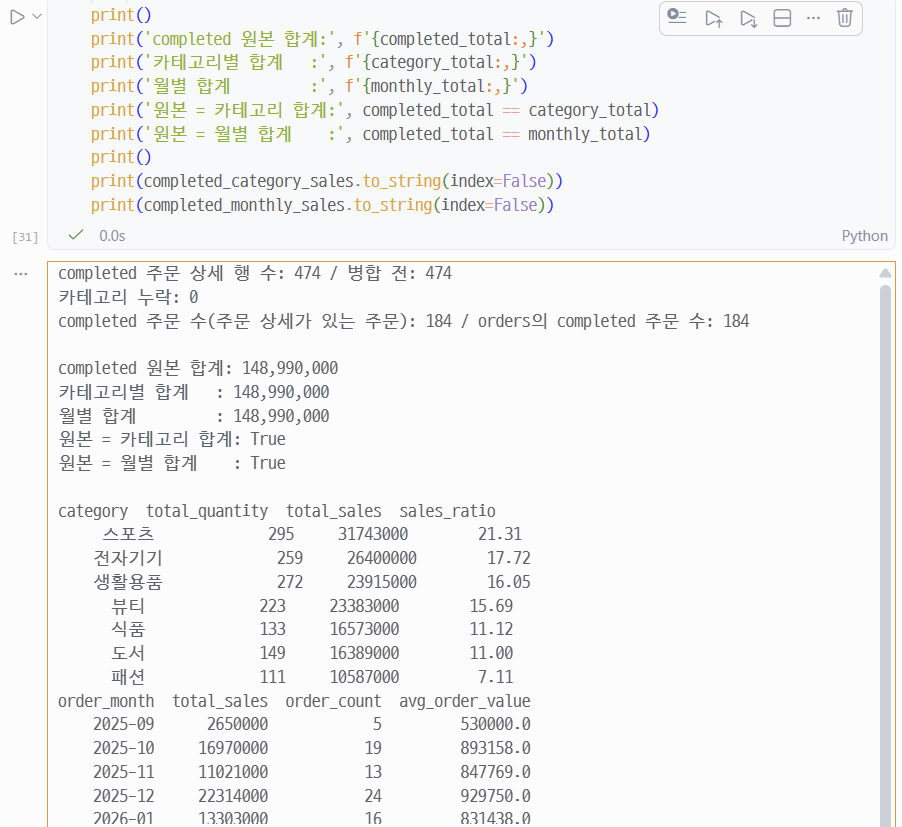

# Chapter 06 답안 양식. 데이터를 보며 질문을 만드는 EDA

> 이 내용을 `chapter06.ipynb`의 Markdown 셀로 작성합니다.

## 제출 정보
- 이름: 배성윤
- GitHub ID: aeuyui
- 작성일: 2026-10-13
- 최종 Notebook URL: https://github.com/aeuyui/llm-data-analysis-study/blob/main/chapter06/chapter06.ipynb

## 1. 내가 정한 EDA 질문
| 질문 | 분석 범위 | 지표 | 검증 방법 |
| --- | --- | --- | --- |
| 카테고리별 completed 주문 수량과 금액은 어떻게 다른가? | order_status가 completed인 주문의 주문 상세(order_items)를 products와 product_id로 병합 | 카테고리별 total_quantity, total_sales(line_total 합계), sales_ratio | 카테고리 합계 = 원본 completed line_total 합계, 병합 전후 행 수 동일, 카테고리 누락 0건 |
| completed 기준 월별 매출과 주문 수는 어떻게 변하는가? | completed 주문의 주문 상세를 orders와 order_id로 병합, 주문 기간 2025-09 ~ 2026-09(13개월) | 월별 total_sales, order_count(고유 order_id), avg_order_value | 월별 합계 = 원본 completed line_total 합계, order_date 누락 0건 |
| 상품 수가 많은 카테고리가 매출도 높은가? | products 100개의 카테고리별 상품 수와 completed 카테고리 매출 | 카테고리별 product_count, total_sales, 상품 1개당 매출(total_sales ÷ product_count) | 상품 수 순위와 매출 순위 비교, 카테고리 합계가 원본 completed 합계와 일치하는지 확인 |

### 왜 이 질문을 선택했는가?
세 질문 모두 현재 데이터의 컬럼으로 계산할 수 있다. order_items와 products는 product_id로, order_items와 orders는 order_id로 병합해도 764행이 유지되고 카테고리/주문일 누락이 없었다. 또한 주문의 38.7%(116/300건)가 cancelled 또는 refunded이므로, 금액 분석은 어떤 상태를 포함하는지 먼저 정해야 한다. 그래서 금액성 질문은 모두 completed 범위로 통일했다. 질문 1은 어떤 상품군이 매출에 기여하는지, 질문 2는 시간에 따른 변화, 질문 3은 상품 구성과 매출의 관계를 본다. 세 질문 결과가 서로 같은 총합으로 맞춰지는지 확인할 수 있어서 계산 검증도 쉽다.

## 2. 핵심 집계 결과
- completed 원본 합계: 148,990,000원 (completed 주문 184건, 주문 상세 474행의 line_total 합계) << 합계를 계산하기 위한 별도 계산 셀을 작성하여 실행함.
- 카테고리별 합계: 스포츠 31,743,000원(21.31%), 전자기기 26,400,000원(17.72%), 생활용품 23,915,000원(16.05%), 뷰티 23,383,000원(15.69%), 식품 16,573,000원(11.12%), 도서 16,389,000원(11.00%), 패션 10,587,000원(7.11%). 합계 148,990,000원
- 월별 합계: 13개월 합계 148,990,000원. 최고 2025-12 22,314,000원(24건), 최저 2025-09 2,650,000원(5건)
- 총합 일치 여부: 일치. 원본 completed 합계 = 카테고리 합계 = 월별 합계 = 148,990,000원. 병합 전후 행 수 474행으로 동일, 카테고리 누락 0건, completed 주문 수 184건으로 orders와 같다.



### 결과 관찰
- completed 기준 카테고리 매출 1위는 스포츠(21.31%), 7위는 패션(7.11%)이다. 상위 4개 카테고리(스포츠, 전자기기, 생활용품, 뷰티)가 전체의 약 70.8%를 차지한다.
- 식품은 판매 수량(133)이 도서(149)보다 적은데 매출(16,573,000원)은 도서(16,389,000원)보다 크다.
- 월별 매출은 2025-12(22,314,000원)가 가장 높고, 가장 낮은 달은 2025-09(2,650,000원), 그다음이 2026-09(3,348,000원)와 2026-08(4,214,000원)이다.
- 월별 평균 주문 금액은 671,733원(2026-07)부터 1,116,000원(2026-09)까지이다. 2026-09는 주문이 3건뿐이다. completed 전체 평균 주문 금액은 약 809,728원(148,990,000 ÷ 184)이다.
- 전체 상태 기준 합계(255,610,000원)와 비교하면 completed 합계는 58.29%이고 차이는 106,620,000원이다. 뷰티는 전체 상태 기준 2위에서 completed 기준 4위로 내려갔다.

### 나의 해석과 판단
- 취소/환불 주문이 300건 중 116건(약 38.7%)이어서 금액 분석은 completed로 제한했다. 전체 상태로 계산하면 매출이 약 106,620,000원 과대평가되고, 뷰티처럼 취소/환불 비중이 큰 카테고리의 순위도 달라진다.
- 세 합계가 같고 병합 전후 행 수도 같으므로, 병합이나 그룹 집계 과정에서 행이 늘거나 사라지지 않았다고 판단했다.
- 카테고리 순위는 수량과 단가 중 무엇의 영향인지 아직 분리하지 못했으므로, 이 표만으로 선호도나 원인을 말하지 않는다.
- 주문이 3~7건뿐인 달은 평균 주문 금액이 한두 건에 크게 좌우되므로 비교에 신중해야 한다.

### 업무/분석적 의미
같은 범위(completed)로 맞춘 카테고리/월별 표를 7장 시각화와 보고서의 기준표로 쓸 수 있다. 상태 범위에 따라 순위와 최저 월이 달라진다는 점을 확인했으므로, 보고서에는 항상 "completed 기준"이라고 범위를 적어야 한다.

### 한계와 추가 확인 사항
- 매출은 line_total(수량 x 단가) 합계이고, 데이터에 할인/배송비 컬럼이 없어 반영되지 않았다(노트북 셀 6 컬럼 목록).
- 주문 기간이 2025-09-14 ~ 2026-09-13이라 2025-09와 2026-09는 한 달 전체가 아닐 수 있어, 두 달이 최저 월에 포함된 것은 기간 때문일 수 있다.
- refunded 주문을 완전히 제외했으므로 환불 금액 자체의 영향은 이 표로 알 수 없다.
- 2026-08은 주문 16건 중 completed가 5건(약 31%)이라 completed 비율이 낮았는데, 그 이유는 이 데이터만으로 알 수 없다.
- 샘플 데이터이므로 실제 업무 데이터의 분포와 같다고 볼 수 없다.

## 3. 관찰 → 가설 → 추가 검증
### 사례 1
- 관찰: 상품 수 상위 4개 카테고리(스포츠 19, 전자기기 17, 생활용품 16, 뷰티 16)가 completed 매출 상위 4개와 같다. 반면 식품은 상품 수가 7개로 가장 적은데 매출은 5위(16,573,000원)이고, 판매 수량(133)이 도서(149)보다 적은데도 매출은 도서(16,389,000원)보다 크다. 상품 1개당 매출은 식품이 약 2,367,571원으로 7개 카테고리 중 가장 높다.
- 가설: 식품은 상품 수는 적지만 평균 단가가 높거나 상품 1개당 판매 수량이 많아서 매출이 클 수 있다. 상품 수가 많은 카테고리의 매출이 높은 것은 상품이 많아 선택지와 상품들의 총 주문 횟수가 많기 때문일 수도 있다. 다만 상품 수 자체의 효과인지는 알 수 없다.
- 추가 검증: 카테고리별 평균 판매 단가(total_sales ÷ total_quantity)와 상품 1개당 판매 수량을 계산하고, 식품 7개 상품별 매출을 확인해 특정 상품에 매출이 몰려 있는지 확인한다.

### 사례 2
- 관찰: 전체 상태 기준 매출 대비 completed 매출의 감소율이 카테고리마다 다르다. 패션 55.5%, 뷰티 50.8%, 식품 50.7%는 크게 줄었고, 생활용품 31.4%, 도서 33.5%, 전자기기 35.6%, 스포츠 36.7%는 상대적으로 덜 줄었다. 그 결과 뷰티는 전체 상태 기준 2위(47,551,000원)에서 completed 기준 4위(23,383,000원)로 내려갔다.
- 가설: 뷰티/패션/식품은 취소/환불로 빠진 주문 상세의 비중이 더 높을 수 있다. 또는 취소/환불된 고액 주문 몇 건이 이 카테고리 매출에 크게 작용했을 수 있다. 또는 표본이 작아 우연일 가능성도 있다.
- 추가 검증: 카테고리별/주문 상태별(completed, cancelled, refunded) 매출과 주문 상세 건수를 계산해 취소/환불 비중을 비교하고, 취소/환불 상위 주문 상세를 확인한다.

### 사례 3
- 관찰: 2026-08은 주문 16건 중 completed가 5건(약 31%)으로 월별 중 가장 낮고, completed 매출 4,214,000원은 같은 달 전체 상태 매출(14,643,000원)의 28.8%이다. 전체 주문의 completed 비율(61.33%)과 차이가 크다. 다음으로 낮은 달은 2026-02(7/16, 약 44%)이다.
- 가설: 이 달에 취소/환불이 늘어난 요인(프로모션, 재고/배송 문제, 특정 결제수단 등)이 있었을 수 있다. 다만 이 데이터에는 원인을 알 수 있는 컬럼이 없다. 또, 주문이 16건뿐이라 비율이 우연히 낮게 나왔을 수도 있다.
- 추가 검증: 월별 order_status 분포(건수/비율)를 계산하고, 2026-08의 cancelled/refunded 주문을 결제수단/카테고리별로 나눠 다른 달과 비교한다. 프로모션이나 재고 정보 같은 외부 자료가 있는지도 확인한다.

## 4. LLM 질문 확장
- Safe Context: 데이터셋 이름과 컬럼 목록(customers에서는 name 제외), 행 수, 주문 기간, completed 기준 카테고리별/월별 집계 요약, 주문 상태 분포만 제공했다. 고객명, customer_id별 구매 내역, 개별 주문 내역은 제공하지 않았다.
- Prompt:

```text
온라인 쇼핑몰 데이터로 EDA를 하고 있습니다. 아래 구조와 집계 요약만 사용해서 다음 분석 질문을 제안해 주세요.

데이터셋(컬럼):
- customers (150행): customer_id, gender, age, city, signup_date
- products (100행): product_id, product_name, category, price
- orders (300행): order_id, customer_id, order_date, payment_method, order_status, order_month, order_dayofweek
- order_items (764행): order_item_id, order_id, product_id, quantity, unit_price, line_total
- 주문 기간: 2025-09-14 ~ 2026-09-13 (13개월)
- 매출 = line_total(수량 x 단가) 합계. 할인, 배송비, 원가 컬럼은 없음.

주문 상태: completed 184건(61.33%), cancelled 64건(21.33%), refunded 52건(17.33%)
completed 주문 기준 합계: 148,990,000원, 주문 184건

completed 기준 카테고리별 요약:
category,product_count,total_quantity,total_sales,sales_ratio
스포츠,19,295,31743000,21.31
전자기기,17,259,26400000,17.72
생활용품,16,272,23915000,16.05
뷰티,16,223,23383000,15.69
식품,7,133,16573000,11.12
도서,14,149,16389000,11.00
패션,11,111,10587000,7.11

completed 기준 월별 요약:
order_month,total_sales,order_count,avg_order_value
2025-09,2650000,5,530000
2025-10,16970000,19,893158
2025-11,11021000,13,847769
2025-12,22314000,24,929750
2026-01,13303000,16,831438
2026-02,5318000,7,759714
2026-03,17529000,24,730375
2026-04,11832000,17,696000
2026-05,16345000,18,908056
2026-06,14070000,18,781667
2026-07,10076000,15,671733
2026-08,4214000,5,842800
2026-09,3348000,3,1116000

관찰한 점:
- 전체 상태 기준 매출 대비 completed 매출이 줄어든 비율은 패션 55.5%, 뷰티 50.8%, 식품 50.7%로 컸고, 생활용품 31.4%, 도서 33.5%, 전자기기 35.6%, 스포츠 36.7%로 작았다.
- 식품은 상품 수가 가장 적은데(7개) 매출은 5위이다.
- 2026-08은 주문 16건 중 completed가 5건뿐이다.

요청:
1. 현재 데이터의 컬럼만으로 계산할 수 있는 다음 EDA 질문 8개를 제안해 주세요.
2. 각 질문마다 필요한 데이터셋과 컬럼, 지표, 사용할 pandas 기능을 정리해 주세요.
3. 현재 데이터로 답할 수 없는 질문 3개를 예로 들고, 각각 답할 수 있는 질문으로 바꿔 주세요.
4. 관찰한 점마다 원인을 단정하지 말고 가설로 표현하고, 가설을 확인할 추가 분석을 제안해 주세요.
5. 데이터에 없는 컬럼이나 정보는 추측하지 마세요.
```

- LLM 제안 요약:

| # | 질문 | 데이터셋 | 컬럼 | 지표 | pandas 기능 | 확인할 점 |
|---|---|---|---|---|---|---|
| 1 | 주문 상태별 비율은 월마다 어떻게 달라지는가? | orders | order_id, order_status, order_month | 월별 전체 주문 수, completed/cancelled/refunded 건수와 비율 | groupby(), size(), unstack(), div(), fillna() | 2026년 8월처럼 completed 비중이 낮은 달을 다른 달과 비교. 원인은 이 분석만으로 알 수 없음 |
| 2 | 카테고리별 취소/환불 비율과 completed 비율은 어떻게 다른가? | orders, order_items, products | order_id, order_status, product_id, category, quantity, line_total | 카테고리별 completed/cancelled/refunded 주문 수와 비율, 상태별 상품 금액 합계 | merge(), groupby(), nunique(), unstack(), crosstab() | 패션/뷰티/식품의 상태별 차이 확인. 한 주문에 여러 카테고리가 있으면 카테고리별 주문 수가 중복 집계될 수 있음 |
| 3 | completed 주문의 월별 상품 금액과 평균 주문 금액은 어떻게 변하는가? | orders, order_items | order_id, order_status, order_month, line_total | 월별 total_sales, 고유 order_count, avg_order_value | merge(), groupby(), agg(), nunique() | 총액 변화가 주문 수와 평균 주문 금액 중 어느 쪽과 함께 나타나는지 확인. 주문별 합계를 먼저 구한 뒤 평균 계산 |
| 4 | 개별 상품별 판매량과 주문 상태 분포에는 어떤 차이가 있는가? | products, order_items, orders | product_id, product_name, category, quantity, line_total, order_id, order_status | 상품별 수량 합계, 상태별 관련 주문 수, completed 상품 금액 | merge(), groupby(), nunique(), sort_values() | 카테고리 합계로 안 보이는 상품별 차이 탐색. 상태 비율의 분모는 해당 상품이 포함된 고유 주문 수 |
| 5 | 결제 수단별 주문 상태 분포는 어떻게 다른가? | orders | order_id, payment_method, order_status | 결제 수단별 주문 수, completed/cancelled/refunded 비율 | crosstab(), groupby(), value_counts(), div() | 차이가 있어도 결제 수단이 취소/환불의 원인이라고 단정할 수 없음 |
| 6 | 고객의 연령대/성별/도시별 구매 패턴은 어떻게 다른가? | customers, orders, order_items | customer_id, age, gender, city, order_id, order_status, line_total | 고객 그룹별 주문 수, 구매 고객 수, completed 주문 금액, 고객당 평균 주문 수 | merge(), groupby(), nunique(), cut(), agg() | 연령대는 분석 편의를 위한 구간으로 정의하고, 그룹별 고객 수를 함께 제시 |
| 7 | 요일별 주문량과 주문 상태 비율은 어떻게 다른가? | orders | order_id, order_dayofweek, order_status | 요일별 주문 수, 상태별 주문 수와 비율 | groupby(), size(), unstack(), reindex() | 특정 요일에 주문이 집중되는지, 상태 비율이 다른지 확인. LLM은 order_dayofweek의 실제 인코딩을 먼저 확인하라고 안내 |
| 8 | 고객별 반복 구매 횟수와 가입일부터 첫 주문까지의 기간은 어떠한가? | customers, orders | customer_id, signup_date, order_id, order_date, order_status | 고객별 전체 주문 수, completed 주문 수, 첫 주문까지 걸린 일수 | merge(), groupby(), nunique(), min(), to_datetime(), 날짜 차이 계산 | 반복 구매 분포와 가입 후 첫 주문까지의 기간 확인. 첫 주문은 전체 기준과 completed 기준으로 구분 가능 |

- 실제 사용 여부: 수정 후 사용
- 판단 이유:
  - 8개 질문 모두 `orders`, `order_items`, `products`, `customers`의 실제 컬럼으로 계산할 수 있고, 할인/원가/취소 사유 같은 없는 컬럼은 쓰지 않았다. 불가능한 질문을 관찰 가능한 질문으로 바꾼 방식도 현재 데이터에 맞다.
  - 질문 1, 2는 3단계의 사례 3, 2를 직접 검증하는 질문이라 사용 가치가 높다. 식품 사례(사례 1)도 LLM이 제안한 상품당 금액/수량 계산으로 확인할 수 있다.
  - 다만 그대로 쓰기 어려운 부분이 있었다. 질문 2와 계산 기준 표에서 카테고리별 비율의 분모가 일관되지 않았고, 질문 3은 이미 2단계에서 계산했으며, 질문 4는 상품당 completed 주문 상세가 평균 약 4.7행이라 상품별 상태 비율의 분모가 작다. 질문 7은 요일이 숫자일 것으로 가정했지만 실제 값은 영문 요일명이었다.

  | 질문 | 판단 |
  |---|---|
  | 1, 2, 5 | 사용 (질문 2는 분모 명시) |
  | 3 | 이미 수행, 중앙값 확인만 추가 |
  | 4 | 수정 후 사용 (상품 단위 상태 비율은 보류, 판매량/금액만) |
  | 6, 7, 8 | 수정 후 사용 |

- 사람이 수정한 내용:
  1. 질문 2의 비율 분모를 "해당 카테고리가 포함된 고유 주문 수"로 명시했다. 한 주문에 여러 카테고리가 들어갈 수 있어 카테고리별 주문 수를 합치면 전체 주문 수보다 커질 수 있으므로, 주문 건수와 주문 상세 행 수를 함께 표시한다.
  2. 질문 3은 이미 같은 표를 만들었으므로 새 분석에서 제외하고, 주문별 금액 합계의 중앙값만 추가 확인 항목으로 남겼다.
  3. 질문 4는 상품별 상태 비율 계산을 보류하고, 상품별 `quantity`와 completed `line_total` 합계, 특히 식품 7개 상품의 매출 분포로 범위를 좁혔다.
  4. 질문 6은 연령대 구간을 직접 정의한다(나이가 19~69세). 그룹별 고객 수를 함께 표시해 도시별 11~21명 같은 작은 그룹이 과대 해석되지 않게 한다.
  5. 질문 7은 `order_dayofweek`가 영문 요일명이므로 숫자 인코딩 확인은 건너뛰고, 월~일 순서로 정렬해 확인한다.
  6. 질문 8은 `signup_date`가 `order_date`보다 늦은 고객이 있는지 먼저 확인한 뒤 첫 주문까지의 기간을 계산한다.
  7. 비율 비교(질문 1, 2, 5, 7)는 월별 주문 수가 6~35건처럼 분모가 작으므로 반드시 건수와 함께 제시한다.

.png)

.png)

## 5. 다음 분석 우선순위
1. 월별/카테고리별 주문 상태(completed, cancelled, refunded) 비율을 건수와 함께 비교한다. orders의 order_status를 order_month별로 집계하고, order_items/products와 병합해 카테고리별 고유 주문 수와 상태별 line_total을 본다. (LLM 질문 1, 2)
2. 카테고리 매출 차이를 판매 수량과 평균 판매 단가(total_sales / total_quantity)로 나누고, 식품 7개 상품의 매출 분포를 확인한다. 카테고리별 상품당 매출과 판매 수량도 함께 본다. (LLM 질문 4의 수정안)
3. 월별 completed 매출을 주문 수, 평균 주문 금액, 카테고리별 매출로 나눠 어떤 요소와 함께 변하는지 확인한다. 2025-09와 2026-09처럼 일부 날짜만 포함된 달은 완전한 월과 구분한다. (LLM 질문 3의 수정안)

### 가장 먼저 확인하고 싶은 이유
주문 상태 범위가 이후 모든 금액 분석의 기준이기 때문이다. 전체 주문 300건 중 116건(약 38.7%)이 cancelled 또는 refunded이고, completed 합계(148,990,000원)는 전체 상태 합계(255,610,000원)의 58.29%이다. 범위를 바꾼 후에는 뷰티가 2위에서 4위로 내려가고 월별 최저 월도 바뀌었다. 이 분석 하나로 사례 2(카테고리별 감소율 차이)와 사례 3(2026-08의 낮은 completed 비율)을 동시에 검증할 수 있고, 현재 컬럼(order_status, order_month, category)만으로 계산할 수 있다. 상태별 차이를 먼저 알아야 이후 수량/단가 분해와 월별 해석에서 어떤 범위를 쓸지 정할 수 있다.

### 현재 데이터만으로 단정할 수 없는 것
- 취소/환불의 원인: 취소/환불 사유, 배송, 고객 문의 컬럼이 없고 order_status만 있다.
- 월별 매출 변화의 원인: 프로모션, 계절성, 신규 상품, 재고 정보가 없다.
- 카테고리의 선호도/인기: 매출이 높다는 사실만으로 선호도가 높다고 말할 수 없다.
- 순매출/이익: line_total은 수량 x 단가이고, 할인/배송비/원가 컬럼이 없다. 환불 금액이 실제로 어떻게 정산되는지도 알 수 없다.
- 2025-09와 2026-09의 월별 비교: 주문 기간(2025-09-14 ~ 2026-09-13) 때문에 한 달 전체가 아닐 수 있다.
- 2026-08의 낮은 completed 비율이 우연인지: 해당 달 주문이 16건뿐이다.
- 상품 수가 많아서 매출이 높은 것인지: 상품 수와 매출의 관계는 관찰일 뿐, 인과는 확인하지 못했다.
- 샘플 데이터이므로 실제 업무 데이터에도 같은 결과가 나온다고 단정할 수 없다.

업무적으로 확인할 가치가 있는 질문(STEP 8):
1. 2026-08에 취소/환불이 늘 만한 이벤트나 재고/배송 이슈가 있었는가
2. 취소/환불 사유 데이터가 따로 있는가
3. line_total에 할인이 반영되어 있는가
4. 환불 주문의 금액을 매출에서 어떻게 처리하는가

## 최종 체크
- [x] 질문과 지표가 연결되어 있습니다.
- [x] 집계 총합을 검증했습니다.
- [x] 관찰과 가설을 구분했습니다.
- [x] 다음 검증 질문을 작성했습니다.
- [x] LLM 제안을 검증했습니다.
- [x] 최종 Notebook URL을 제출합니다.